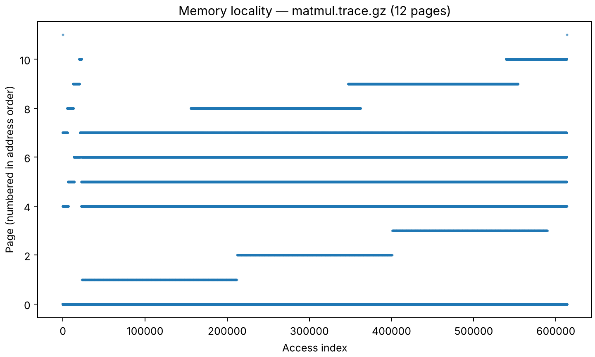
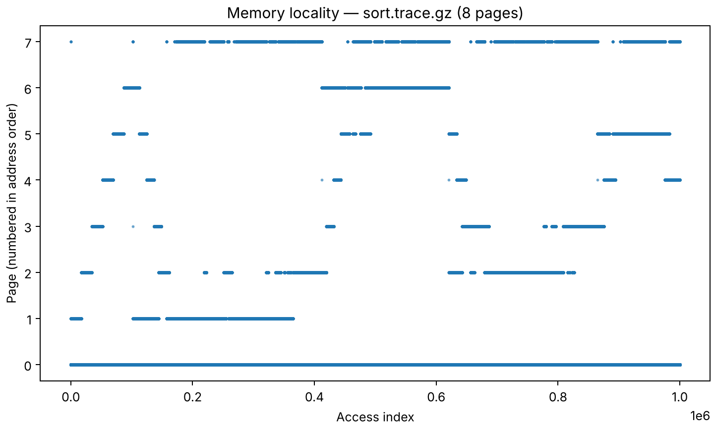
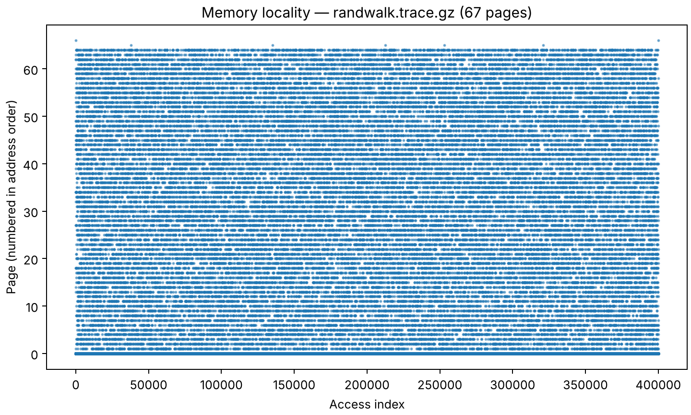
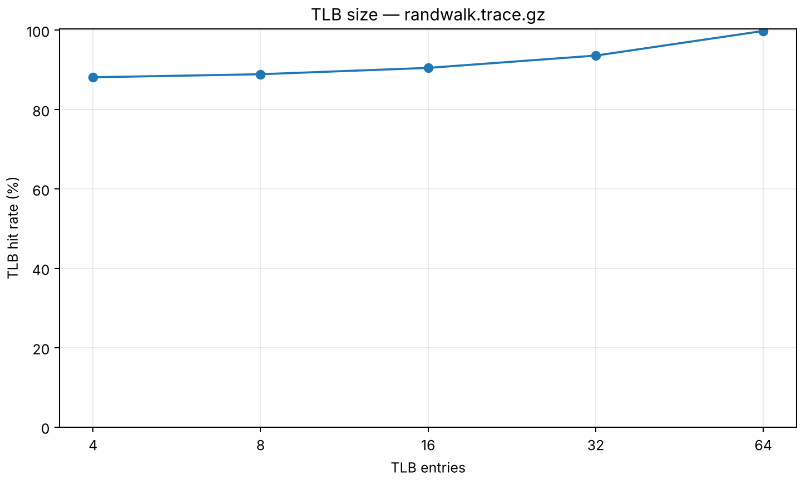
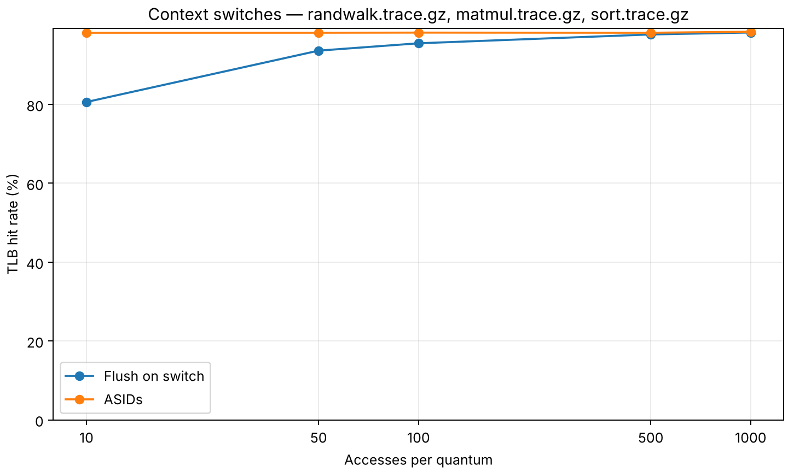
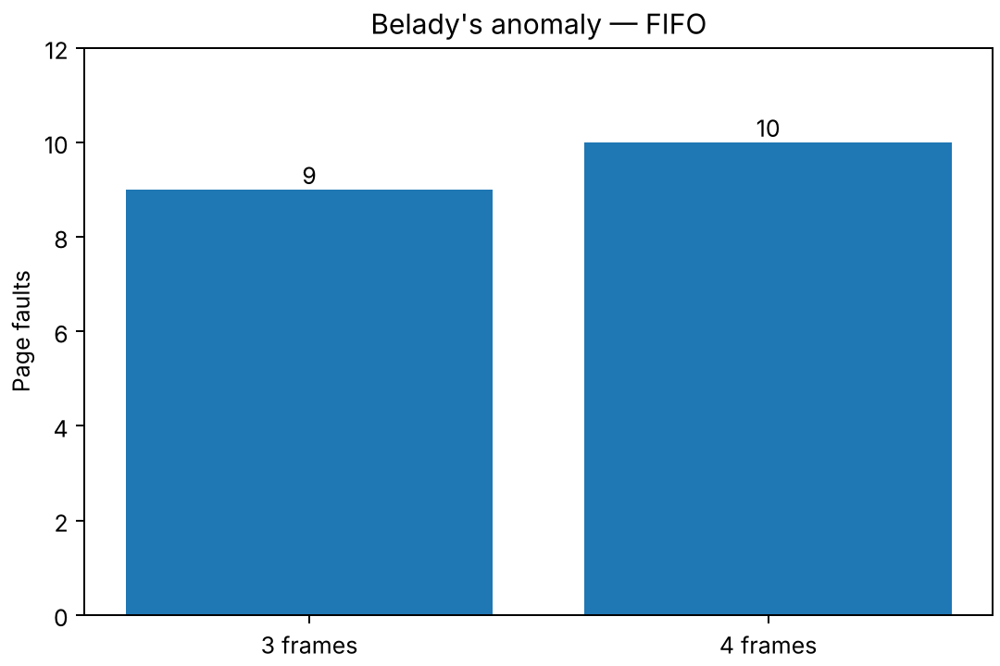
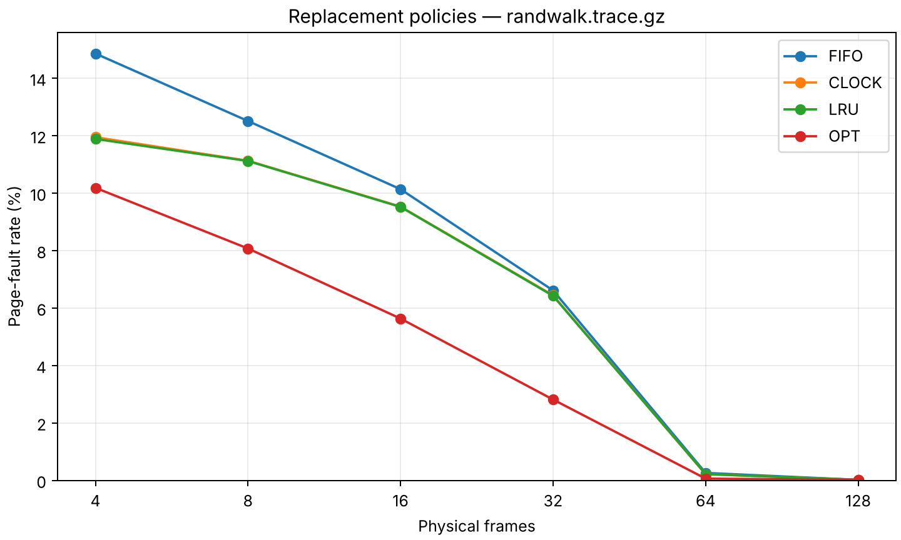

# Virtual Memory Simulator: Design Document

CSE 4300 Operating Systems, Fall 2026

Team: Aaron, Keaden, Johann, Michael, Martin

## 1. Overview

We built a simulator that shows what the MMU and the operating system do every time a program touches memory. For each access it:

1. checks the TLB for the translation,
2. walks a two-level page table if the TLB misses,
3. handles a page fault if the page isn't in physical memory,
4. picks a page to evict when memory is full, writing it to swap first if it's dirty.

Instead of making up memory accesses, we ran three small C programs under Valgrind's lackey tool, which logs every load, store and instruction fetch a program makes. The simulator replays those logs. It reports TLB hit rate, page fault rate and swap traffic, it can run several programs as separate processes with context switches between them, and it writes an event log that our web visualizer plays back one step at a time.

The project covers most of the memory part of the course: paging and two-level page tables, the TLB and context switches, swapping, and page replacement (FIFO, Clock, LRU and OPT, plus Belady's anomaly).

## 2. How the pieces fit together

The simulator is a Python package (`src/vmsim/`). Each part has one owner:

| File | What it does | Owner |
|---|---|---|
| `trace.py` | reads lackey traces, makes synthetic traces, interleaves processes | Aaron |
| `sim.py`, `__main__.py` | runs a trace through the MMU, writes the log, prints stats, command line | Aaron |
| `pagetable.py`, `frames.py` | two-level page tables and the physical frame table | Michael |
| `mmu.py` | handles one memory access from start to finish | Michael |
| `tlb.py` | the TLB | Johann |
| `replacement.py` | FIFO, Clock, LRU and OPT | Martin |
| `swap.py` | swap space | Martin |
| `visualizer/index.html` | replays the event log in a browser | Keaden |

```
lackey trace -> trace.py -> sim.py -> mmu.py
                                        |-- pagetable.py, frames.py
                                        |-- tlb.py
                                        |-- replacement.py, swap.py

sim.py --log  -> events.jsonl -> visualizer/index.html
experiments/  -> run the MMU over many settings -> charts
```

We agreed on the interfaces between the parts on the first day (function names, arguments and the event log format), so everyone could build and test their own part with small fake versions of the others and then plug everything together.

### What happens on one memory access

This is the core of `MMU.access()`:

1. Work out the virtual page number: `vpn = vaddr >> 12` (4 KB pages).
2. Ask the TLB. On a hit we already have the frame, so skip to step 6.
3. On a TLB miss, look the page up in the process's page table. If the entry is valid, put the translation in the TLB and go to step 6.
4. Otherwise it's a page fault. Take a free frame if there is one. If not, ask the replacement policy for a victim frame. If the victim page is dirty, write it to swap. Then mark its page table entry invalid, remove it from the TLB, and tell the policy the frame is empty.
5. If the page we're loading has a copy in swap, read it back. Map the page into the frame, tell the policy it's loaded, and add it to the TLB.
6. Tell the policy about the access, set the referenced bit, and set the dirty bit if it was a write.
7. Return an event describing everything that happened.

## 3. Traces and simulation driver (Aaron)

### What it does

My part handles the input and runs the other components together. `trace.py` turns a memory trace into `Access` records. Each record has a process ID, an operation, and a virtual address. `sim.py` passes those records to Michael's MMU in order, saves the events, and collects the stats. `__main__.py` reads the command-line options so we can run different settings without editing the code.

| File | What it handles |
| --- | --- |
| `src/vmsim/trace.py` | Reads Lackey logs, generates workloads, and interleaves process traces |
| `src/vmsim/sim.py` | Runs accesses through the MMU, writes events, and returns summary stats |
| `src/vmsim/__main__.py` | Reads command-line options and starts the run |
| `scripts/make_traces.sh` | Builds the test programs and records their traces |
| `tests/test_trace.py` | Checks parsing, gzipped traces, the access limit, loop generation, and interleaving |
| `tests/data/sample.trace` | Small hand-written input used by the parser tests |

### Trace format and parsing

Valgrind's Lackey tool can record instruction fetches, loads, stores, and modify operations while a program runs. A trace line contains an operation, a hexadecimal address, and an access size:

```
I  00401000,4      instruction fetch
 L 00403008,8      load (read)
 S 00402000,4      store (write)
 M 00403000,8      modify (read then write)
```

The parser skips Valgrind headers and lines that do not match the expected format. Following our project plan, `I` and `L` become reads (`R`), while `S` and `M` become writes (`W`). Each accepted line becomes one `Access` record. The access size helps identify the trace format, but the parser uses the starting address to represent the access, so a reference that crosses a page boundary still produces one record.

`load_lackey(path, pid, limit)` also limits how many accesses we read. The default is 1,000,000 records per file, which keeps larger logs manageable. It reads plain or gzipped files. The process ID is assigned when the file is loaded, so two programs can use the same virtual address and still have separate pages.

### Collecting real traces

My first version of `make_traces.sh` traced `ls`, `pwd` and `sort` and kept the first 5,000 accesses of each. When we looked at those traces, they turned out to be the dynamic loader starting up. The first 5,000 accesses of `ls` touch 14 pages, all in the loader, and never reach `ls` itself. Even an empty C program makes about 350,000 accesses before `main` runs.

To get traces of real work, `make_traces.sh` now builds three small C programs (in `scripts/programs/`) without the C library (`gcc -nostdlib -static`), using a tiny `_start` function that calls `main` and then exits with a system call. That way the whole trace is our program. The script keeps only the access lines from Lackey's log and gzips them, which shrinks the three traces from 33 MB to about 1 MB. The parser reads the gzipped files directly.

We picked programs with very different access patterns:

| Trace | Program | Accesses | Pages touched |
|---|---|---|---|
| `matmul` | multiplies two 40x40 matrices of doubles | 613,263 | 12 |
| `sort` | quicksorts 6,000 random numbers | 1,357,392 | 8 |
| `randwalk` | reads and writes random spots in a 256 KB array | 400,017 | 67 |

The charts below show which page each access touches over time. The stack sits at a much higher address than the code and data, so the pages are numbered in address order to keep the chart readable. Matmul uses a few pages for the whole run (code, stack and the current row of `a`) and moves through the pages of `b` and `c` in phases. Sort moves back and forth across its array as quicksort splits it. Randwalk touches all 64 data pages almost evenly, so it has basically no locality.







### Generated workloads and multiple processes

The `synthetic()` function gives us three access patterns for testing. Sequential moves 8 bytes at a time and wraps around after reaching the configured address range. Loop touches the start of each page and then repeats. Random picks pages using a fixed seed so we can compare policies with the same input. These generated traces use read operations.

For multiple processes, `interleave(traces, quantum)` gives each trace up to `quantum` accesses per turn. Finished traces drop out, and the others keep running until every access has been processed. The driver calls the MMU's context-switch method whenever the process ID changes. The printed switch count excludes the initial dispatch. The MMU's internal counter includes that first dispatch.

### Running the simulation and saving events

The command line supports trace files, generated workloads, frame count, TLB size, replacement policy, TLB policy, context-switch quantum, ASIDs, and an optional log path. Multiple `--trace` arguments represent multiple processes. For OPT, the driver builds the exact ordered `(pid, vpn)` sequence from the accesses that will be simulated, after the trace limits and interleaving have been applied.

The first line of the event log records the configuration. Each later line records an access or a process switch, with a step number added by the driver:

```
{"type": "config", "frames": 4, "tlb_size": 4, "policy": "clock", "tlb_policy": "lru", "asid": false}
{"type": "access", "t": 0, "pid": 1, "op": "R", "vaddr": "0x401000", "vpn": 1025,
 "tlb": "miss", "pt": "fault", "frame": 0, "evict": null, "swap_in": false, "tlb_evict": null}
{"type": "switch", "t": 50, "from": 1, "to": 2, "flushed": true}
```

| Field | Meaning |
|---|---|
| `tlb` | `hit` or `miss` |
| `pt` | `null` if the TLB hit, `hit` if the page table had it, `fault` for a page fault |
| `frame` | the physical frame the page is in |
| `evict` | the page that was kicked out to make room (with its dirty bit and swap slot), or `null` |
| `swap_in` | `true` if the page was read back from swap |
| `tlb_evict` | the TLB entry that got pushed out, or `null` |
| `flushed` | on a context switch, whether the TLB was flushed |

The driver converts an evicted TLB entry into an object with `pid` and `vpn` fields when saving the log. At the end, it reports total accesses, TLB hits and misses, TLB hit rate, page faults and fault rate, swap reads and writes, and context switches. It also returns these values in a dictionary so other Python code can use the results.

### Testing and results

The five trace tests pass. They check that the parser skips the sample header and assigns the correct read/write operations, reads gzipped traces the same as plain ones, respects a two-access limit, generates the expected repeating page addresses, and gives each process the correct turn during interleaving.

We first checked the whole pipeline with the four-access sample trace, two frames, a two-entry TLB, and FIFO. The run produced 1 TLB hit, 3 misses, and 3 page faults, and the final access evicted page 1, which was clean, and placed page 3 in frame 0. The event log loaded into Keaden's visualizer and its final counters matched the terminal output.

With the real traces, running matmul alone with 8 frames, a 16-entry TLB and LRU gives 613,263 accesses, 16 TLB misses and 16 page faults, since its 12 pages almost fit. Running all three programs as separate processes with 16 frames, Clock and a quantum of 500 gives 2,013,280 accesses, a 97.4% TLB hit rate, 47,059 page faults and 3,254 context switches. The results for the different policies and TLB settings are in sections 5 and 6.

## 4. Page tables and the MMU (Michael)

### Address translation

We use 4 KB pages, so the low 12 bits of an address are the offset inside the page and the rest is the virtual page number (VPN). For the two-level page table, the VPN is split again: the top part (`vpn >> 18`) picks an entry in the outer table, and the low 18 bits pick the entry in an inner table.

Each page table entry (PTE) holds:

| Field | Meaning |
|---|---|
| `frame` | physical frame number, if the page is in memory |
| `valid` | the page is in memory right now |
| `dirty` | the page was written since it was loaded |
| `referenced` | the page was used since it was loaded |
| `swap_slot` | where the page's copy in swap is, if it has one |

### Why two levels

The point of a two-level table is that inner tables only exist for parts of the address space a process actually uses. We store both levels as Python dictionaries, so an inner table is only created the first time a page in its range gets mapped.

All three of our programs keep their code and data at low addresses and their stack just below `0x1ffeffc000`, so each one only needs two inner tables (outer entries 0 and 127). A single flat table covering the same address space would need an entry for every possible VPN, which is 2^36 entries. Even counting each inner table at its full size of 2^18 entries, two levels need about 524,000 entries per process instead of about 69 billion.

### Frames and evictions

`FrameTable` keeps a fixed number of physical frames shared by all processes, so replacement is global: a fault in one process can evict another process's page. It hands out the lowest free frame and remembers which `(pid, vpn)` is in each frame, which the MMU needs when it evicts a page.

When a page is evicted, the MMU marks its PTE invalid but keeps the entry, so the dirty bit and swap slot aren't lost. If the page is dirty, it's written to swap first. The MMU also removes the page from the TLB, so the TLB can never point at a frame that now holds someone else's page.

When a page comes back from swap, the MMU reads it but keeps the swap copy and loads the page as clean. If the page gets evicted again without being written, its copy in swap is still correct, so no new write is needed, and the next fault reads it from swap again. Our first version freed the swap slot on every swap-in, so a page that came back and then left again without changes was forgotten and treated like a brand new page. That undercounted swap reads a lot (for LRU on two real traces with 8 frames, 35 reads instead of 749), so we changed it and added a test for it.

### Context switches

`MMU.context_switch(new_pid)` tells the TLB the running process changed and returns an event saying whether the TLB was flushed.

## 5. TLB (Johann)

The TLB is a small cache of recent translations from `(pid, vpn)` to a frame. The MMU checks it before the page table, so a hit skips the page table walk completely.

The MMU uses four methods:

| Method | When it's called |
|---|---|
| `lookup(pid, vpn)` | on every access, returns the frame or nothing and counts a hit or miss |
| `insert(pid, vpn, frame)` | after a TLB miss, returns the entry it pushed out (for the log) |
| `invalidate(pid, vpn)` | when a page is evicted from memory |
| `context_switch(new_pid)` | when the running process changes |

**Organization.** By default the TLB is fully associative, so any translation can go in any slot. It can also be set associative (`ways` option): the entries are split into sets, and a page can only go in set `vpn % number_of_sets`.

**Replacement.** When the TLB is full we evict either the least recently used entry or a random one. LRU uses an `OrderedDict`: every hit moves the entry to the end, so the front is always the oldest. Random replacement uses a fixed seed so runs can be repeated.

**Flushing vs ASIDs.** Entries are keyed by `(pid, vpn)`, so two processes using the same page number never get mixed up. By default the TLB is flushed on every context switch, which is what hardware without address space IDs (ASIDs) has to do. With `--asid`, the process ID acts as the ASID, so entries from different processes stay in the TLB together and nothing is flushed.

### Results

All TLB numbers are on our real traces.

**TLB size.** On randwalk with LRU, the hit rate is 88.1% with 4 entries, 90.5% with 16 and 93.6% with 32, then jumps to 99.8% at 64 entries, which is when the TLB is big enough to hold all of randwalk's 64 data pages. Matmul and sort touch so few pages that even a tiny TLB almost always hits. Running all three programs together, LRU only clearly beats random replacement when the TLB is tiny (89.8% vs 86.5% with 2 entries). From 8 entries up they're within half a percent of each other.



**Flushing vs ASIDs.** Context switches are where the TLB design matters most. Running all three programs and switching every 10 accesses, flushing drops the hit rate to 80.6%, because each process starts with an empty TLB every time it runs. With ASIDs the hit rate stays at about 98% (99.6% with a 64-entry TLB) no matter how often we switch. As switches get rarer the gap closes: at 1,000 accesses per switch, flushing is 98.2% and ASIDs are 98.4%, because refilling the TLB after a flush gets spread over more accesses.



To see what this means for speed, `effective_access_time()` estimates the average cost of one access. A hit costs one TLB check plus one memory access. A miss costs a TLB check, two memory accesses to walk the two-level table, and one more for the data. With 1 ns for the TLB and 100 ns for memory, 98% hits works out to about 105 ns per access and 80.6% hits to about 140 ns, so frequent flushing makes memory about a third slower in this model.

## 6. Page replacement and swapping (Martin)

When there's a page fault and no free frame, the MMU asks the replacement policy which frame to empty. The policy only picks the frame. The MMU does the actual eviction (writing to swap, updating the page table and the TLB).

### The policies

Every policy has the same four methods: `on_load(frame)` when a page is put in a frame, `on_access(frame)` on every single access (TLB hits included), `on_evict(frame)` when a frame is emptied, and `choose_victim()`. `make_policy(name, num_frames, future)` creates the right one by name, so the MMU never needs to know which policy it's using.

| Policy | How it keeps track | What it evicts |
|---|---|---|
| FIFO | a queue of frames in the order they were loaded | the page that was loaded first, no matter how much it's used |
| LRU | an `OrderedDict` that moves a frame to the end on every access | the page that hasn't been used for the longest time |
| Clock | a reference bit per frame and a "hand" that goes around in a circle | the first page the hand finds with its bit cleared, clearing bits as it goes (second chance) |
| OPT | the whole future trace, with a list of upcoming positions for each page | the page that won't be needed for the longest time, or never again |

A real OS can't do OPT because it can't see the future, but our simulator has the entire trace up front, so OPT shows the best any policy could possibly do. OPT keeps a counter of where it is in the trace and uses `(pid, vpn)` to identify pages, so two processes using the same page number stay separate.

### Swap space

`SwapSpace` keeps track of which page is in which slot and counts reads and writes. It only tracks metadata, not the actual page contents. Writing a page that already has a slot reuses that slot, and freed slots are reused before new ones are made. Only dirty pages are written when they're evicted, since a clean page either has a correct copy in swap already or never had anything worth saving.

### Results

We checked the policies against the examples from lecture first. On the reference string 0 1 2 0 1 3 0 3 1 2 1 with 3 frames, FIFO and Clock get 7 faults and LRU and OPT get 5. On the classic string 1 2 3 4 1 2 5 1 2 3 4 5, FIFO gets 9 faults with 3 frames but 10 faults with 4 frames, which is Belady's anomaly: giving FIFO more memory made it worse.



On the real randwalk trace (400,017 accesses, 67 pages) with a 16-entry TLB:

| Frames | FIFO | Clock | LRU | OPT |
|---:|---:|---:|---:|---:|
| 4 | 59,444 | 47,794 | 47,548 | 40,741 |
| 8 | 50,044 | 44,512 | 44,476 | 32,291 |
| 16 | 40,548 | 38,120 | 38,083 | 22,532 |
| 32 | 26,447 | 25,769 | 25,695 | 11,251 |
| 64 | 1,031 | 852 | 864 | 237 |
| 128 | 67 | 67 | 67 | 67 |



A few things stand out:

- OPT is always the best, and the gap is big. With 32 frames it has less than half the faults of the others.
- LRU and Clock are almost the same everywhere. Clock is meant to approximate LRU with just one bit per frame, and here it does that very well.
- FIFO is the worst, mostly at small memory sizes. Randwalk's data is random, but its code and stack pages are used all the time. LRU and Clock keep those pages because they're always being used, while FIFO keeps evicting them just because they were loaded a while ago.
- Once there are enough frames for all 67 pages (128 frames), every policy only has the 67 faults needed to load each page the first time.

The other two traces barely need replacement. Matmul with 4 frames has 12,714 faults with FIFO, 7,786 with LRU and 5,662 with OPT, but with 8 frames LRU drops to just 16, because its working set fits.

## 7. Visualizer (Keaden)

The visualizer (`visualizer/index.html`) is one HTML file with plain JavaScript and no libraries. You open it in a browser, pick an event log with the file picker, and step through the simulation. It doesn't need a server and it doesn't change the simulator. It only reads the log.

It has four panels:

- **TLB entries:** `PID, VPN -> frame`
- **Physical frames:** which process and page is in each frame
- **Page tables:** every page each process has touched, whether it's valid, dirty, and which swap slot holds its copy
- **Swap space:** which page is in each slot

Above the panels are counters for TLB hits, TLB misses, page faults and swap writes, plus a line explaining the current event in words. The frame being used is highlighted green for a TLB hit, yellow for a TLB miss the page table handled, and red for a page fault.

The page rebuilds the state from the log one event at a time: a miss adds a TLB entry, a fault fills a frame, an eviction marks the old page invalid and removes it from the TLB, a dirty eviction fills a swap slot, and a context switch with `flushed: true` empties the TLB. There are Next, Previous, Play and Pause buttons and a speed slider. Previous works by replaying everything from the start up to the step before, which is simpler and safer than trying to undo each change.

We checked it by loading a real log of 300 accesses (matmul and sort as two processes, 4 frames, 4 TLB entries, Clock) and stepping through to the end. Its counters matched the log exactly: 282 hits, 18 misses, 17 faults and 8 swap writes.

The visualizer can only show what's in the log, so it can't show things like the page table indices. Big logs are also slow to step through backwards, so for the demo we use a few hundred accesses.

## 8. Testing

Everyone wrote tests for their own part, and `python3 -m pytest tests` runs all 89 of them:

- **Traces:** header lines skipped, read/write types right, the limit works, gzipped traces load the same as plain ones, interleaving switches at the right place.
- **Driver and command line:** the stats for the sample trace, the event log format (config line first, a step number on every event, TLB evictions saved as `pid` and `vpn`), context switch counting, OPT with several processes, and the command line's output and error messages.
- **Page tables and MMU:** mapping and lookup across both levels, a fault on first touch and a TLB hit after, dirty pages going to swap and coming back, clean pages not being written, pages coming back from swap being read again after a clean eviction, two processes with the same page number, TLB entries removed on eviction, and the exact event format.
- **TLB:** hits and misses, the size limit, LRU picking the right victim, repeatable random replacement, invalidate, flushing on a switch, ASIDs keeping entries, set associativity and the access time formula.
- **Replacement and swap:** the lecture examples, Belady's anomaly, each policy's victim choice (including Clock's second chance and OPT keeping processes separate), bad input, and swap slot reuse and counting.
- **Policies inside the MMU:** the lecture examples and Belady's anomaly through the real MMU and TLB, memory staying consistent with every policy (with and without ASIDs), OPT never having more faults than the other policies, only dirty pages going to swap, and LRU still seeing accesses that hit in the TLB.
- **End to end:** a small synthetic trace through the whole simulator.

Building the parts separately against fake versions of each other worked well. When we put everything together, all the parts connected without changes to the interfaces. The bugs we found during integration were in the experiments and in swap accounting, not in how the parts fit together.

## 9. Limitations

- We simulate when things happen, not timing or real data. Swap only tracks which page is in which slot, and the access time numbers come from a simple formula.
- All processes share one pool of frames (global replacement). We don't model per-process limits or the working set model.
- The traces come from small programs built without the C library. That keeps them clean, but real programs with shared libraries would touch a lot more pages.
- Processes never exit, so swap slots are never freed in practice.
- OPT needs the whole trace ahead of time, so it's only useful as a best-case comparison.

## 10. Who did what

| Person | Part |
|---|---|
| Aaron | trace parsing, synthetic traces, interleaving processes, simulation driver, command line, test programs and traces |
| Michael | two-level page tables, frame table, MMU access and context switch logic |
| Johann | TLB (LRU, random, ASIDs, set associativity), team test setup, TLB experiments |
| Martin | FIFO, Clock, LRU and OPT, swap space, experiment script and charts |
| Keaden | web visualizer, event log replay, slides |
